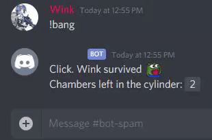
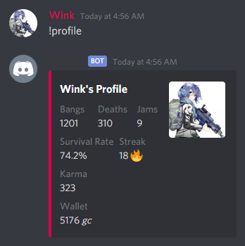

Version 2.2
# Purpose
This is a Discord bot intended to provide entertainment to users of the
University of Guelph Bachelor of Computer Science Discord server.

# Technologies
Written in Java with JDA API and built with Gradle.  
Using MariaDB to store user info, game data, and message logs.  
Hosted on a Google Cloud server with 24/7 uptime.

# Features

### Play Russian Roulette

### Earn money in black jack

### Track your scores

### Share the love

### Spend money on profile customization

### Instantly create and join private channels

### Log Messages and File Uploads

### Buttons and slash commands
Every `!command` also works as a slash command (type `/` to browse them), and the
moments that used to need typing now have buttons: **Hit / Stand** on your blackjack
hand, **Higher / Lower / Cash out** in Higher or Lower, **A-D** answers on arcade,
quiz, trivia and duel questions, **Accept / Decline** on a duel challenge,
**Confirm** on contributions and featured shop prices, and quick links on your profile card.
Text commands are unchanged and behave identically.

### Animated profile cards
`!profile gif on` (or the ✨ Animate button) turns your profile card into a looping GIF: the
mascot bobs, stars twinkle and a glint sweeps across. It is off by default, saved per person,
and falls back to the still card if the GIF would be too large to send.

### And much much more

# Reading the code? Where to start:
In src lies 3 package: command, database, and main (plus economy, arcade and duel for the game logic).

command: Defines all commands used by the bot.  
database: Defines the connectors to the database
and any methods which may be used to send SQL instructions to it.  
command.ui: Buttons and slash commands. Both are rewritten into the equivalent
text command and run through the normal command list, so there is one code path
per feature (see `SyntheticMessage`, `SlashCommands`, `Buttons`).  
main: Required startup code, EventListener overrides, and reading
data from a configuration file

Each package and its subpackages contain a package-info file
explaining its contents.

# Have Questions or Want to Contribute?
All inquiries should be sent to Wink#0001 on Discord.
I am always open to improving the bot in any way!
