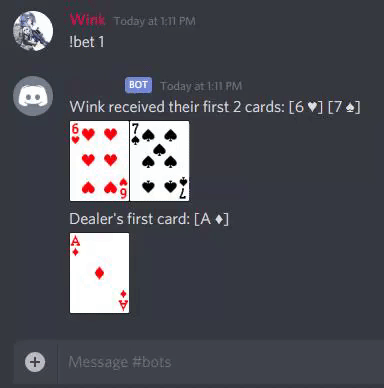
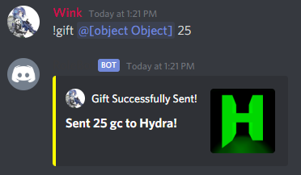
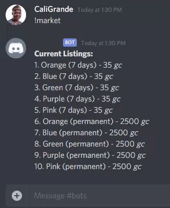
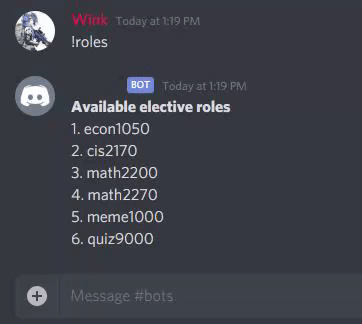
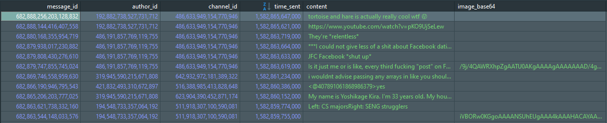
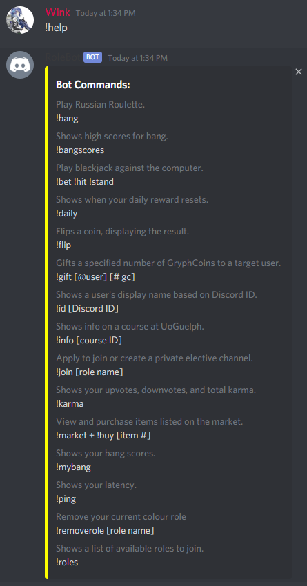

Version 2.2
# Purpose
This is a Discord bot intended to provide entertainment to users of the
University of Guelph Bachelor of Computer Science Discord server.

# Technologies
Written in Java with JDA API and built with Gradle.  
Using MariaDB to store user info, game data, and message logs.  
Hosted on a Google Cloud server with 24/7 uptime.

# Features

### Play Russian Roulette

### Earn money in black jack

### Track your scores

### Share the love

### Spend money on profile customization

### Instantly create and join private channels

### Log Messages and File Uploads

### Buttons and slash commands
Every `!command` also works as a slash command (type `/` to browse them), and the
moments that used to need typing now have buttons: **Hit / Stand** on your blackjack
hand, **Higher / Lower / Cash out** in Higher or Lower, **A-D** answers on arcade,
quiz, trivia and duel questions, **Accept / Decline** on a duel challenge,
**Confirm** on contributions and featured shop prices, and quick links on your profile card.
Text commands are unchanged and behave identically.

### Animated profile cards
`!profile gif on` (or the ✨ Animate button) turns your profile card into a looping GIF: the
mascot bobs, stars twinkle and a glint sweeps across. It is off by default, saved per person,
and falls back to the still card if the GIF would be too large to send.

### Games with pictures and animation
`!slots <stake>` spins three reels as a GIF, `!roulette` spins a wheel, `!crash` climbs a multiplier you pick a cash-out for, `!scratch` scratches off a card, `!mines` is a 4x4 board of buttons, `!flip [heads|tails] [stake]` spins a coin that lands on
the result, `!dice` tumbles two dice, Higher or Lower shows each card, and `!bang` animates the cylinder
and the shot, then settles on a card with your mascot and streak. The result text appears once the animation has
played, so it never spoils it, and each game has a replay button. Nothing caps a stake; blackjack warns
you when a bet is more than half your balance.

Two more are played against other people: `!coinduel @user <stake>` is a coin flip for equal stakes, and
`!race <stake>` puts a stake on a trivia question for the first right answer to take. `!wordle` is the daily
five-letter word with a flip-over board, a reward and a streak. All the animated games share one rate limit
of a game every few seconds per player, so nobody can flood the channel.

### Course info
`!info cis3750` shows the whole entry under an animated banner (when it is offered, hours, credits,
description, prerequisites, co-requisites, equivalent courses and restrictions) with a button for each related
course and one to join the course channel. `!prereq cis3750` draws the chain of prerequisites as a tree. The
catalogue covers both the undergraduate and graduate calendars; `res/scrape.py` rebuilds it. It also searches:
`!info intro programming` finds courses by title words, `!info cis` lists a department, and `/info`
autocompletes as you type.

### Planning your courses
`!completed add cis1300 math1200` keeps what you have finished, `!next` shows the courses whose prerequisites that
list meets, and `!whynot cis3750` says what is missing for one (anything it cannot check, like a credit count, is
marked as a maybe). `!remind friday 5pm hand in lab` sends a reminder by DM, `!dates` lists the next dates on the
academic calendar with a bell to be reminded the day before, and `!rate cis1300 3 4` / `!reviews cis1300` collect
anonymous difficulty and workload ratings that show up in `!info` (you can only rate a course you have added
to your finished list). `!prereq` colours its tree by what you have finished.

### Planning further
`!plan cis3750` draws the earliest route to a course, term by term, using the terms each course runs and what you
have finished (`!completed`) and are taking now (`!taking`; `!classmates cis2750` shows who else is, for people who
opted in). `!compare cis2500 cis2520` sets courses side by side. `!due add cis2500 lab3 friday 5pm` tracks
deadlines with a reminder the day before, and `!digest on` sends a morning summary by DM. `!grade`, `!grades`
and `!need` are a private grade tracker (sent by DM only). `!motion off` turns every animation into plain text for
you, and moderators can check on the bot with `!botstatus`.

### And much much more

# Reading the code? Where to start:
In src lies 3 package: command, database, and main (plus economy, arcade and duel for the game logic).

command: Defines all commands used by the bot.  
database: Defines the connectors to the database
and any methods which may be used to send SQL instructions to it.  
command.ui: Buttons and slash commands. Both are rewritten into the equivalent
text command and run through the normal command list, so there is one code path
per feature (see `SyntheticMessage`, `SlashCommands`, `Buttons`).  
main: Required startup code, EventListener overrides, and reading
data from a configuration file

Each package and its subpackages contain a package-info file
explaining its contents.

# Have Questions or Want to Contribute?
All inquiries should be sent to Wink#0001 on Discord.
I am always open to improving the bot in any way!
